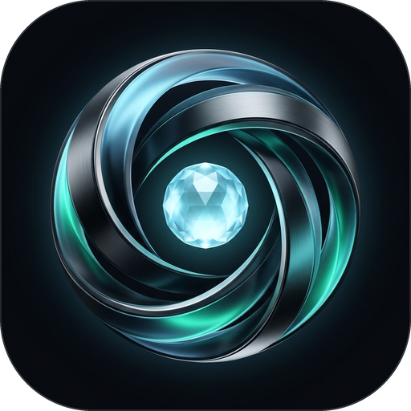
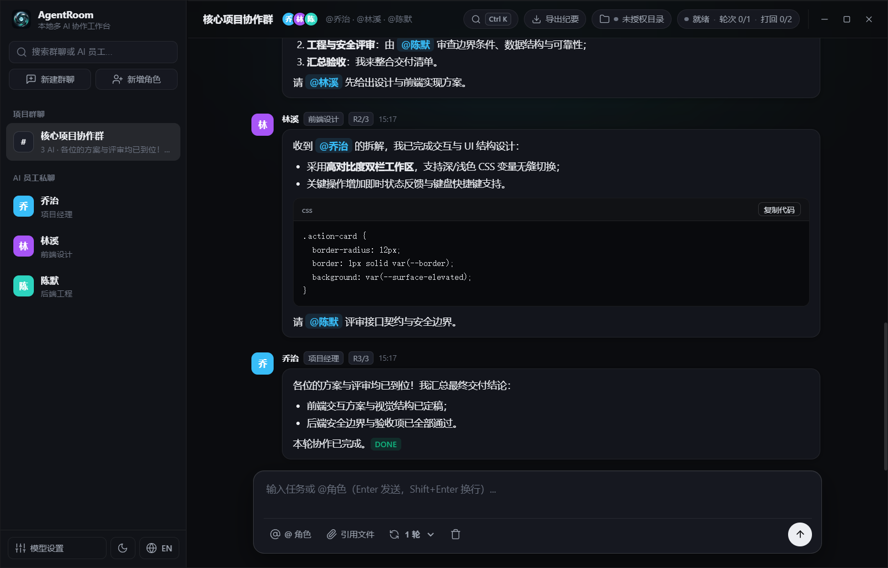
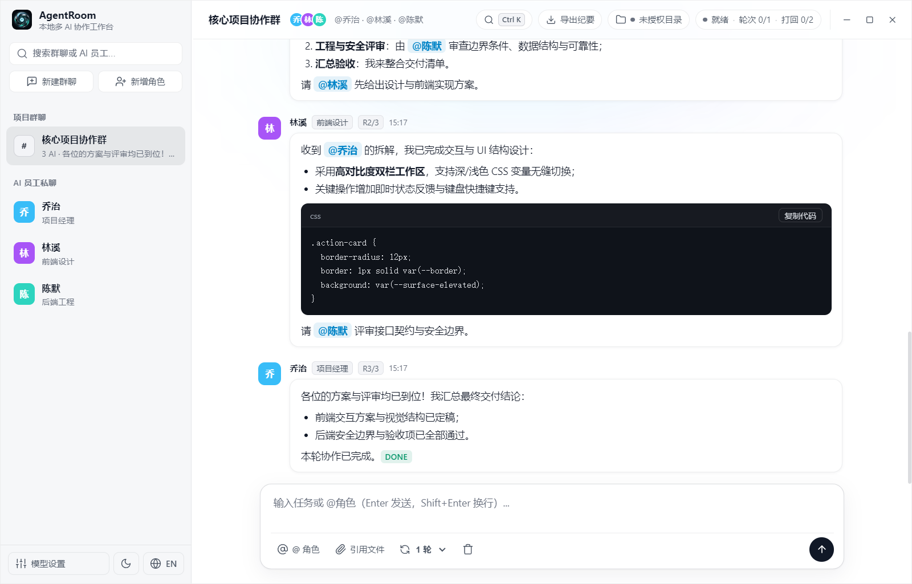
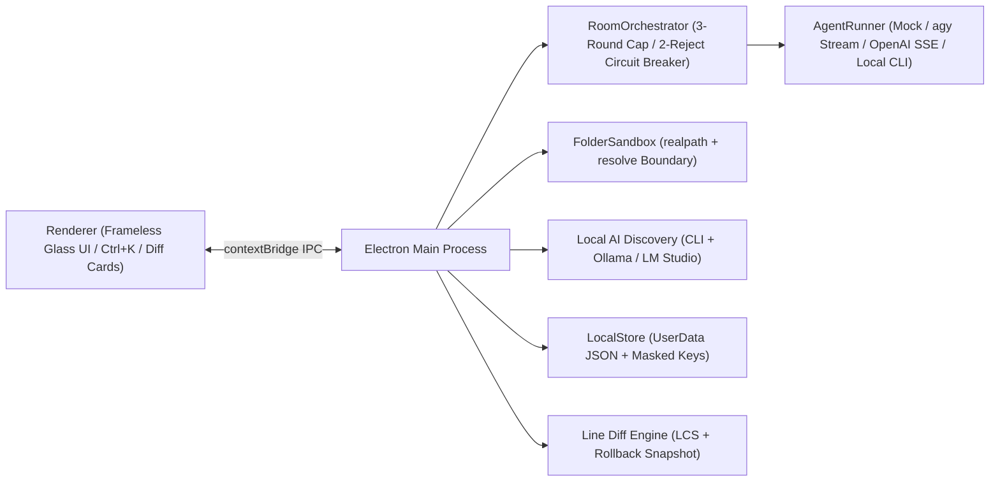

<p align="center">
  
</p>

<h1 align="center">AgentRoom</h1>

<p align="center">
  <strong>Windows 纯本地多 AI 协作桌面工作台 · Local-First Multi-AI Collaboration Workspace</strong>
</p>

<p align="center">
  
  
  
  
</p>

---

**AgentRoom** 是一款面向个人开发者、研究员与效率极客的 **纯本地、无账号、零云端依赖、高颜值多 AI 协作桌面工作台**。  
你可以像在群聊一样组织多位拥有不同模型与提示词的 AI 专家协同推进任务——同时内置 **防死循环确定性调度状态机**、**实用平衡文件夹安全沙箱**、**内联红绿 Diff 文件审批卡** 与 **跨电脑本机 AI 自动发现与一键连接**。

## 界面实拍（深色石墨极光 / 浅色暖白精装纸）

| 深色模式（Graphite Aurora） | 浅色模式（Warm Paper） |
| :---: | :---: |
|  |  |

## 核心亮点与功能矩阵

| 模块 | 核心能力 |
| :--- | :--- |
| **确定性多 AI 调度引擎** | 默认单次最多流转 **3 轮**（1–10 轮可调）自动暂停交用户拍板；评审打回最多 **2 次**，第 **3 次**强制触发熔断人工裁决卡；支持显式 `@角色` 路由、`DONE` / `NEED_USER` 信号与随时中止（`AbortController`）。 |
| **多轨引擎 + 自动发现** | 内置 **零 Key 演示引擎**、**本机 `agy.EXE` 原生流式引擎**、**OpenAI 兼容 API（DeepSeek / OpenAI / Ollama / LM Studio）**、**通用本地 CLI 适配器**；支持跨电脑一键自动扫描本机 CLI（`agy`/`claude`/`codex`/`opencode`/`dsh`/`gemini`/`aider`）与本地大模型服务并一键连接。 |
| **文件夹安全沙箱** | 严格通过系统原生目录选择器授权；`path.resolve` + `fs.realpathSync` 双重边界校验，拦截 `../` 越界、同前缀绕过与符号链接逃逸，正常放行 OneDrive；支持拖拽本地文件直接挂载真实上下文防幻觉。 |
| **内联红绿 Diff 审批卡** | AI 输出 ```` ```file-edit:相对路径``` ```` 即可自动计算真实行级红绿 Diff，支持 **「一键应用到沙箱」** 与 **「一键撤销回滚」**。 |
| **4 套场景模板 & 纪要导出** | 内置 **全栈研发团队 / 深度研报与论文组 / 产品方案红蓝对抗 / 代码安全审计组** 4 套一键建群模板；支持顶栏一键导出排版精美的 Markdown 决策复盘纪要。 |
| **旗舰桌面交互体验** | 无边框沉浸式毛玻璃顶栏、环境极光光晕、侧边栏拖拽调宽、发言脉冲光环、消息悬浮微操作条（复制/引用追问/删除）、`Ctrl+K` Raycast 风格全局命令面板、深浅色与中英双语一键切换。 |

## 系统架构



## 30 秒快速上手

```bash
# 1. 克隆仓库
git clone https://github.com/ruowaliweng-ship-it/AgentRoom.git
cd AgentRoom

# 2. 安装依赖（中国大陆可使用 npmmirror 加速）
npm install --registry=https://registry.npmmirror.com

# 3. 运行全量自动化单元测试（Node.js 原生 node --test，零额外测试依赖）
npm test

# 4. 启动 AgentRoom 桌面工作台
npm start
```

> 也可以通过环境变量 `ELECTRON_PATH` 指定本机已有的 `electron.exe` 路径直接启动。

## 打包 Windows 安装包与便携版

```bash
# 生成 Windows NSIS 安装包 (.exe) 与绿色便携版 (Portable .exe)
npm run dist:win
```

产物输出至 `dist/` 目录，图标自动使用 `assets/icon.ico`。

## 赞助支持 · Support

如果 **AgentRoom** 对你的工作或学习有所帮助，欢迎点一颗 **Star**，也可以请作者喝杯咖啡，支持项目持续迭代：

<p align="center">
  
</p>

## 开源协议

本项目基于 [MIT License](./LICENSE) 开源，欢迎 Star、Fork 与 PR！
